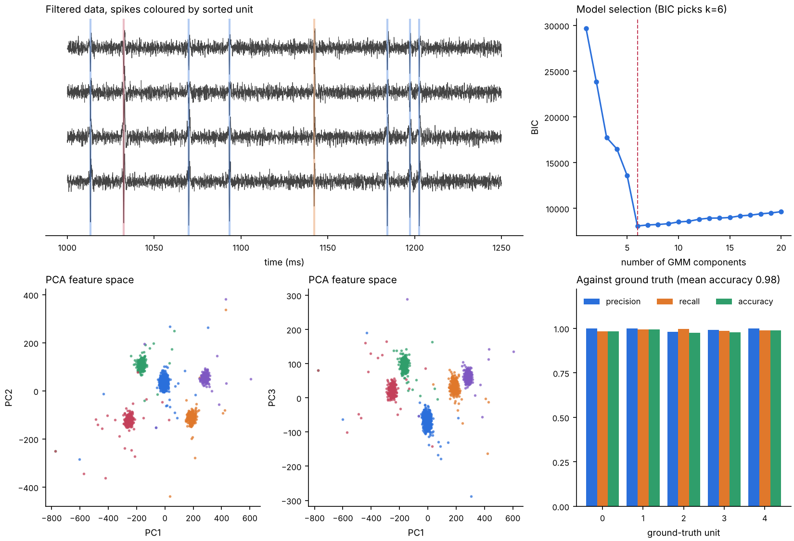
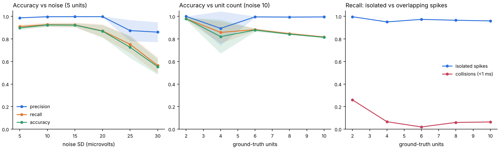
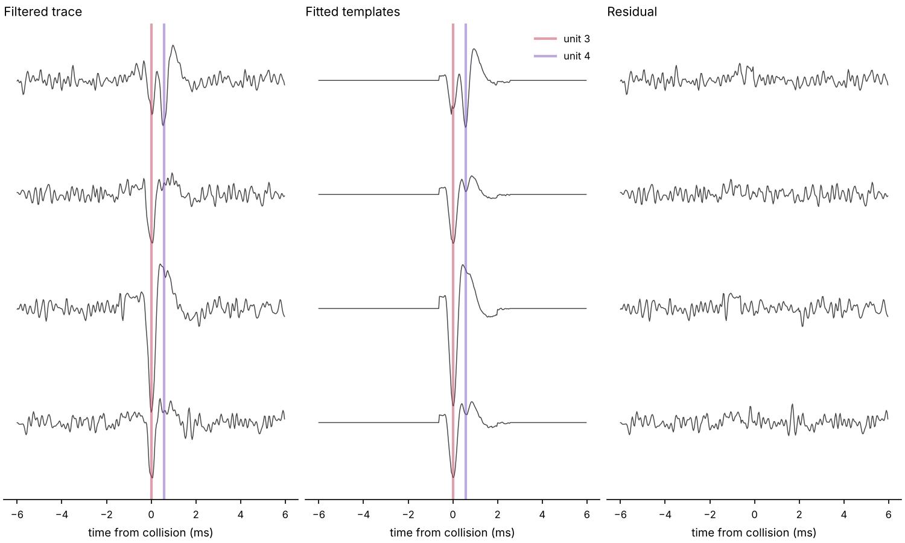
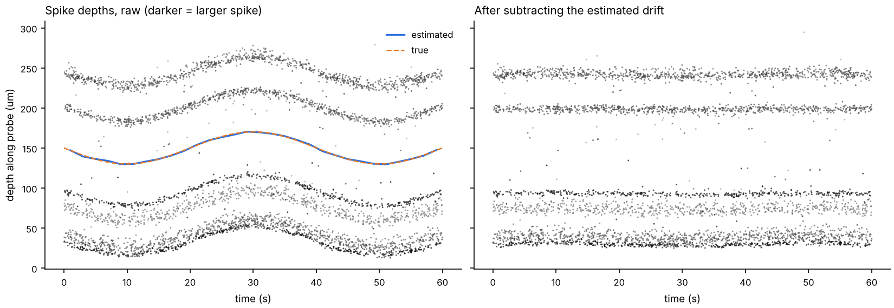
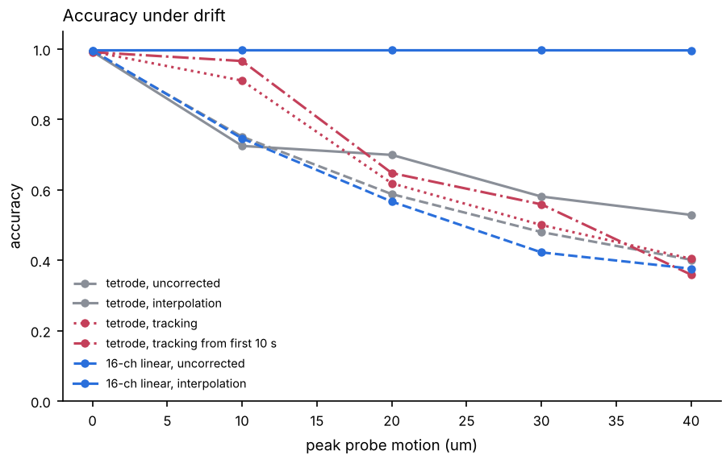

# spikesort

A spike sorter written from scratch in NumPy and SciPy, benchmarked against simulated recordings where the true answer is known.

Spike sorting takes raw voltage from an extracellular electrode and works out which neuron fired each spike. Production sorters like Kilosort and MountainSort are large and hard to see inside. This one implements the classic two-stage design in a few hundred readable lines, then measures exactly where it succeeds and where it fails: stage one detects and clusters spikes to learn one template per neuron, and stage two goes back to the raw trace and explains it as a sum of those templates, which is what recovers spikes from two neurons that fired at the same time.



## Pipeline

```
raw voltage
  -> bandpass 300-6000 Hz (zero-phase Butterworth)
  -> drift correction (optional, linear arrays): estimate motion from spike
     depths, re-interpolate channels so every neuron stays put
  stage one
  -> detect: union of a 5 sigma threshold (1 ms dead time) and a smoothed
             multichannel energy score (2 ms dead time)
  -> align: centre of mass of the trough, sub-sample, cubic spline resampling
  -> features: PCA on the concatenated multichannel waveform (6 components)
  -> cluster: Gaussian mixture, number of units chosen by BIC
  -> split: test each cluster for a hidden second unit (held-out d')
  -> merge: join over-split clusters (template similarity + cross-fitted d')
  -> templates: median waveform per cluster, composite clusters dropped
  stage two
  -> match: greedy matching pursuit on the filtered trace, sub-sample shifts,
            positions and amplitudes refined with neighbours subtracted
  -> score: ground-truth matching (Hungarian) and GT-free quality metrics
```

| Module | What it does |
|---|---|
| `simulate.py` | Synthetic recordings: biphasic spike templates with distance-dependent amplitude across channels, Poisson spike trains with a refractory period, band-limited correlated noise, an LFP-like slow offset, optional probe motion. Tetrode and linear probe geometries. |
| `preprocess.py` | Bandpass, common median reference, robust MAD noise estimate (Quiroga et al. 2004). |
| `detect.py` | Threshold and smoothed-energy detectors, dead time, three alignment modes. |
| `features.py` | PCA via SVD, global or per-channel. |
| `cluster.py` | GMM with BIC, split and merge passes, cluster separation (d'). |
| `matching.py` | Template selection, FFT matched filtering, greedy matching pursuit with refinement. |
| `drift.py` | Spike depths, pairwise histogram registration with least-squares reconciliation, kriging channel shift. |
| `tracking.py` | Experimental: chunked matching with templates that follow their units, merging and discovery. |
| `evaluate.py` | SpikeForest-style accuracy, Hungarian matching, ISI violations, SNR, isolation distance (Harris et al. 2001), collision analysis. |

## Quick start

```bash
pip install -e ".[dev]"
spikesort demo --units 5 --duration 60 --seed 0 --out results/
spikesort demo --no-matching ...                                # stage one only
spikesort demo --probe linear --units 8 --motion 20 --drift-correction ...
spikesort sort my_recording.npy --fs 30000 --out results/       # (n_samples, n_channels) array
spikesort sort my_recording.npy --fs 30000 --positions chans.npy  # (n_channels, 2) um, enables drift correction
pytest
```

The demo prints what each stage did, per-unit quality metrics, and the score against ground truth:

```
stage 1: 1747 events in 7 clusters, 1 dropped as composite
stage 2: 5 matching rounds, 1780 spikes in 6 units
unit  n_spikes  rate_hz   snr  isi_viol  iso_dist
   0       745    12.42  17.7    0.0000     209.5
   1       317     5.28  18.7    0.0000     236.8
   2       261     4.35  24.6    0.0000     135.8
   3       244     4.07  31.0    0.0000      38.6
   4       181     3.02  19.6    0.0000     216.1
   5        32     0.53   3.6    0.0645       6.4

unit  matched  n_gt   n_sorted  precision  recall  accuracy
   0        1    322       317      1.000   0.984     0.984
   1        4    181       181      1.000   1.000     1.000
   2        3    239       244      0.980   1.000     0.980
   3        2    264       261      0.996   0.985     0.981
   4        0    752       745      1.000   0.991     0.991
mean accuracy: 0.987
```

Accuracy follows the SpikeForest definition, matched / (ground truth + sorted - matched), so it penalises misses and false positives together.

The sixth unit is 32 noise events that happened to cluster together, a side effect of the sensitive detector. It matches no real neuron and the quality table flags it without any ground truth: SNR 3.6 where the real units are above 17, isolation distance 6 where they are above 38, and refractory violations. A curation step would drop it. This one leaves the decision to the reader.

## Results

Each point is the mean of 3 random seeds, 60 s recordings, simulated tetrode. Three sorters are compared: stage one alone, the full pipeline, and matching with templates built from the true labels, which bounds what matching can do given perfect stage-one output. With the current pipeline every condition sits on that bound: over all 33 runs the gap is 0.0001 on average and 0.005 at worst, and every unit is found in every run. Reproduce with `python benchmarks/sweep.py`.



| Condition | Clustering only | With matching | True templates |
|---|---|---|---|
| 5 units, noise 5 uV | 0.90 | 0.99 | 0.99 |
| 5 units, noise 10 uV | 0.92 | 0.99 | 0.99 |
| 5 units, noise 15 uV | 0.93 | 0.99 | 0.99 |
| 5 units, noise 20 uV | 0.93 | 0.99 | 0.99 |
| 5 units, noise 25 uV | 0.92 | 0.98 | 0.98 |
| 5 units, noise 30 uV | 0.89 | 0.95 | 0.95 |
| 2 units, noise 10 uV | 0.98 | 1.00 | 1.00 |
| 4 units, noise 10 uV | 0.93 | 0.99 | 1.00 |
| 6 units, noise 10 uV | 0.87 | 0.98 | 0.99 |
| 8 units, noise 10 uV | 0.84 | 0.97 | 0.97 |
| 10 units, noise 10 uV | 0.82 | 0.97 | 0.97 |

| Across the unit-count sweep | Clustering only | With matching | True templates |
|---|---|---|---|
| recall, isolated spikes | 0.98 | 1.00 | 1.00 |
| recall, overlapping spikes (another unit within 1 ms) | 0.11 | 0.92 | 0.92 |
| precision | 0.99 | 0.99 | 0.99 |

### Finding 1: clustering alone loses almost every collision

With stage one alone, isolated spikes are recovered 95 to 100% of the time at every unit count, while spikes with another neuron firing within 1 ms are recovered 2 to 26% of the time (0.11 on average in the current sweep). Precision stays near 1.0, so the problem is not confusion between neurons. When two spikes overlap, the summed waveform matches neither template and lands in a junk cluster. As the unit count rises from 2 to 10, the collision fraction climbs from 2% to 15% of all spikes, and that accounts for most of the drop in accuracy. Every threshold-and-cluster sorter shares this ceiling.

### Finding 2: template matching removes that ceiling, and what is left is unit discovery



Stage two takes the stage-one templates back to the filtered trace and runs matching pursuit: find the template and time whose subtraction removes the most energy, subtract it, repeat. Removing the first spike of a collision exposes the second. Recall on overlapping spikes goes from 0.09 to 0.90, against 0.92 with the true templates. The figure shows two units firing 0.6 ms apart, fitted down to noise.

At the time this was built, in the 28 of 33 runs where stage one found every neuron, the full pipeline was within 0.012 of the true-template bound in every run and within 0.001 on average (mean accuracy 0.986, against 0.884 for clustering alone). The remaining gap, at 25 to 30 uV noise and in one 4-unit seed, came entirely from stage one failing to produce a template: a small unit lost under the detection threshold, or two near-identical neurons merged into one cluster. Matching cannot fit a template it was never given, and the missing unit's spikes get assigned to the closest existing one, which is why precision dipped in exactly those runs. Finding 6 closes that gap.

The matched filter is also a much better detector than a single-sample threshold. In the 30 uV run where stage one did find every unit, the 5 sigma threshold had caught 63% of isolated spikes, because the smaller units peak at 3 to 4 sigma. The matched filter integrates over the whole multichannel waveform, and once a template exists it recovered 99% of them, taking that run from 0.65 to 0.96.

Five details that mattered, each found by watching the method fail:

* **Detect with unit amplitude, estimate amplitude afterwards.** Letting the amplitude float during detection let the first spike of a close collision swallow part of the second, which then fell under threshold. Detection now uses fixed-amplitude templates, and amplitudes are fitted at the end with neighbours removed.
* **Rank fits by absolute energy removed.** Ranking by the fraction of a template's own energy let a small template fitted at 1.25x beat the correct fit of a large one.
* **Refine with neighbours subtracted.** A greedy fit made next to an unexplained spike is pulled towards it. After each round, every spike near a new fit is restored and re-fitted against the cleaner residual, which corrected timing errors of 1 to 2 samples and amplitude errors of 20%.
* **Let the re-fit change its mind about the template.** An earlier version of the figure above showed a three-spike pile-up fitted down to noise. Checking it against ground truth showed two spikes: the sorter had explained one large spike as two smaller templates stacked on top of each other, both pinned at the bottom of the amplitude range. The re-fit now considers every template at the restored position, so the right one takes over and the other falls under threshold.
* **Keep the acceptance threshold low and add a noise floor.** A collision partner sitting on the first spike's rebound has a correlation well below its template energy. Requiring only that a fit reduce the residual energy, plus a 5 sigma floor measured from the matched-filter output itself, lifted collision recall from 0.46 to 0.60 on one seed with no change in precision.

### Finding 3: alignment is the biggest lever in stage one

Reproduce with `python benchmarks/alignment.py` (stage one only, threshold detector, no split pass: the configuration at the time).

| Units | Noise (uV) | Integer | Parabola | Centre of mass |
|---|---|---|---|---|
| 5 | 5 | 0.69 | 0.91 | 0.90 |
| 5 | 10 | 0.85 | 0.92 | 0.92 |
| 5 | 15 | 0.82 | 0.85 | 0.92 |
| 5 | 20 | 0.82 | 0.82 | 0.87 |
| 5 | 25 | 0.61 | 0.64 | 0.73 |
| 2 | 10 | 0.65 | 0.98 | 0.98 |
| 8 | 10 | 0.76 | 0.83 | 0.84 |
| **all** | | **0.74** | **0.85** | **0.88** |

The first version aligned each spike to the sample holding its minimum. A filtered spike's true trough usually falls between two samples, so noise decides which one wins. Every neuron became two populations one sample apart, PCA separated them cleanly, and the clusterer reported each neuron twice. The giveaway was a clean 50/50 split of one neuron where the difference between the halves matched the waveform's time derivative.

Parabolic refinement fixes that at high SNR. For smaller spikes, the noisy minimum wanders several samples along a broad trough, and a parabola only corrects within half a sample. Aligning on the trough's centre of mass averages over many samples, so the noise mostly cancels.

Counterintuitively, integer alignment does worst at the *lowest* noise level. Clean data makes the two offset populations tight enough to look like separate neurons.

### Finding 4: global PCA beats per-channel PCA

The classic tetrode recipe runs PCA separately on each channel (3 components x 4 channels = 12 features). On an 8-channel probe that becomes 24 dimensions, and a full-covariance GMM needs about 300 parameters per component. With a few hundred spikes per neuron, BIC's penalty swamps the likelihood gain and similar neurons get merged. One PCA on the concatenated waveform, keeping 6 components, raised stage-one accuracy on an 8-channel probe from 0.49 to 0.90 and on a tetrode from 0.82 to 0.88 (before the alignment fix).

### Finding 5: score separation on held-out spikes

The merge pass joins two clusters only if their templates correlate above 0.97, their amplitudes are within 15%, and their spike clouds overlap (d' below 2.5 along the axis between their means). Measured naively, d' is inflated by double-dipping. A random split of one neuron scores d' of about 1 when the axis and the score come from the same 100 spikes in 60 dimensions. `separation()` is therefore cross-fitted: the axis comes from half the spikes and d' is scored on the other half.

The split pass uses the same held-out scoring in the other direction: each cluster is divided by a two-component mixture on half its spikes, and the split is kept only if the other half separates at d' above 4. It was off by default for a while, because with BIC's search capped at 20 components it rarely fired. Finding 6 is where it earned its place.

### Finding 6: a smoothed multichannel detector finds the small units

The last gap in the noise sweep was unit discovery. At 25 to 30 uV the smallest unit peaks at 3.4 to 4.1 sigma, so a 5 sigma threshold on single samples caught 6 to 23% of its spikes, and the few it caught were the noise-inflated ones. In one seed they were too few to form a cluster, in another they merged into a neighbour. Either way stage two had no template to look for.

The fix is the same idea as stage two, without a template: correlate each channel with a generic spike-shaped pulse (a 0.12 ms Gaussian), which integrates over the trough and gains two to three times in signal-to-noise, then combine channels as the root sum of squares of the negative deflections. That detector catches 94 to 97% of the smallest unit's spikes. Two details:

* **It fires on the filter's undershoot.** The band-pass leaves a shallow negative lobe 1 to 2 ms after every large spike, coherent across channels, and at low noise the combined score crosses threshold there: 500 to 1000 false events per minute. A per-channel floor on the smoothed score and a 2 ms dead time remove them. The dead time costs nothing in stage one, because collision partners are stage two's job.
* **Changing the event set flips knife-edge clusters.** Two units on the same channel with the same amplitude and templates correlating at 0.96 were split by BIC with one detector's events and merged with the other's. The stage-one events are now the union of both detectors, and the held-out split pass runs by default. The split pass also separates the pair that an earlier version of this README called inseparable (4 units, seed 2: 0.63 to 0.99).

Noise 25 uV goes from 0.82 to 0.98 and noise 30 uV from 0.79 to 0.95, both equal to the true-template bound. Over the whole sweep, clustering alone averages 0.90 and the full pipeline 0.98.

### Finding 7: drift can be estimated from the spikes and undone, on a linear array



Real probes move relative to the tissue by tens of microns over a recording. The simulator now moves the electrodes along a slow sinusoid (one and a half cycles per recording) so each spike's per-channel amplitudes depend on when it fired. Nothing in the sorter assumed that, and it shows: on a 16-channel linear probe with 20 um of motion, stage one splits every unit into several clusters that are active at different times, and accuracy falls from 1.00 to 0.61, and to 0.39 at 40 um.

The correction follows Kilosort 2.5. Every detected spike gets a depth, the centre of mass of its squared per-channel trough amplitudes along the shank. The recording is cut into 2 s bins, each bin becomes an amplitude-weighted depth histogram, every pair of bins is registered by cross-correlation, and the pairwise shifts are reconciled into one trajectory by weighted least squares. The filtered data is then re-sampled along the shank at each sample's displacement with a Gaussian-kernel interpolant, and the ordinary pipeline runs on the result. Three passes, because the centre of mass under-reads motion by about 10% and each pass picks up most of what is left. Reproduce with `python benchmarks/drift.py`.

| Peak motion (um) | Tetrode | Tetrode, interpolation | Tetrode, tracking | Tetrode, tracking from first 10 s | Linear 16-ch | Linear, interpolation | Drift estimate error (um) |
|---|---|---|---|---|---|---|---|
| 0 | 0.99 | 0.99 | 0.99 | 0.99 | 1.00 | 1.00 | 0.6 |
| 10 | 0.75 | 0.72 | 0.91 | 0.97 | 0.75 | 1.00 | 0.9 |
| 20 | 0.59 | 0.70 | 0.62 | 0.65 | 0.57 | 1.00 | 0.8 |
| 30 | 0.48 | 0.58 | 0.50 | 0.56 | 0.42 | 1.00 | 0.9 |
| 40 | 0.40 | 0.53 | 0.40 | 0.36 | 0.38 | 1.00 | 0.9 |

Means of 2 seeds, 60 s recordings. On the linear probe the corrected accuracy at every motion level equals the no-motion accuracy, and the trajectory is recovered to within 1 um rms (the 0.6 um at zero motion is the estimator's own noise floor). Uncorrected, stage one reports 13 to 24 clusters for 8 neurons. The two tracking columns are Finding 8.



Things that mattered:

* **Units beyond the ends of the array break the estimate.** The first attempt used an 8-channel probe with units placed up to 15 um past its ends, and the estimated trajectory was off by 12 um rms. A unit beyond the last channel has a centre of mass pinned near that channel, and as it moves further away the centre of mass can even move the wrong way. Interior units on a 16-channel probe track motion at 0.89 um per um. Real probes are long, so this is mostly a short-array problem, but it is also why depth estimates need care near the ends.
* **Read amplitudes at the trough, not as each channel's minimum.** The minimum over a 2 ms window of a noise-only channel is always a few sigma negative, which biased every spike towards the middle of the array and doubled the per-spike depth noise.
* **Register all pairs of bins, not each bin against its predecessor.** Chaining neighbours accumulates error over the recording. The least-squares reconciliation of all pairs does not, and pairs of bins that share no units simply get a low weight.
* **A tetrode cannot really be corrected this way.** Four channels on a square give no axis to interpolate along, and the kernel interpolant is a poor model of the field between them. Applied anyway, it recovers a part of the loss at 20 um and above (0.59 to 0.70 at 20 um, 0.40 to 0.53 at 40 um) and nothing at 10 um. Following templates over time is the tetrode answer, and Finding 8 is what came of that.

### Finding 8: following templates over time helps a tetrode only sometimes

A tetrode has no axis to interpolate along, so its drift answer has to be the Kilosort 1 one: let each template follow its neuron. `tracking.py` is an experimental stage two that processes the recording in 5 s chunks, moves each template towards the median of the spikes it just won (with the other units' spikes subtracted), merges templates that have become one neuron, and clusters whatever the templates could not explain to find units that appear late. `SortConfig(tracking=True)` turns it on. It is benchmarked above, as the two tracking columns.

It is a modest and unreliable gain, and the reason is instructive. A Gaussian mixture cuts a continuously drifting neuron into amplitude bands, and every band becomes a template that keeps winning the spikes in its own band, so nothing ever converges. Three ways of proving two bands are one neuron were tried, and each has a hole:

* **Waveform overlap (cross-fitted d')** says no, correctly: the bands are different waveforms.
* **Refractoriness** (the two spike trains never come within 1.5 ms of each other, when chance says they should) is the standard test, and it decides interleaved bands well, but bands of a drifting neuron are active at different phases of the drift and never interleave, so the test has no power in a 60 s recording.
* **A density gap test** (the bands are adjacent slices of a continuum with no valley between them) works for a slow random walk and fails for oscillating drift, which dwells at its extremes and leaves a real valley. With a few hundred spikes per cluster it also cannot tell a continuum from two neurons at d' of 3. It is in `cluster.py` as `gap_ratio`, off by default.

What does work is the handover: a template that has tracked its neuron onto a stale band's position becomes the same waveform as that band's template, and the two are merged on template similarity at that moment. Starting the templates from the first 10 s of the recording avoids most bands but costs precision (0.58 to 0.83 at 20 um and above), because a template occasionally drifts onto a different neuron and discovery adds junk. At 10 um of motion, where bands are rare, tracking takes the tetrode from 0.75 to 0.91, or 0.97 from the first 10 s. At 20 um and beyond the gain over no correction is a few hundredths. Long recordings help all of this: on a 120 s tetrode recording with 20 um of motion the full-recording variant reached 0.80 and the first-10-s variant 0.87, against 0.55 uncorrected.

## Running on other data

`benchmarks/real_data.py` runs the sorter on anything SpikeInterface can load and scores it against a ground-truth sorting, with both this project's scorer and SpikeInterface's. Data hosts are not reachable from the environment this was built in, so the real recordings are a job for a laptop:

```bash
pip install spikeinterface numba
python benchmarks/real_data.py --generate --units 6 --channels 4 --duration 30
python benchmarks/real_data.py --generate-drift --motion 20 --duration 60
python benchmarks/real_data.py --mearec path/to/recording.h5
python benchmarks/real_data.py --recording path/to/rec --sorting path/to/gt_sorting
```

The two `--generate` modes use SpikeInterface's own generators, which differ from this simulator in every detail that matters (ellipsoid templates, spatially correlated noise, 5% amplitude jitter, zigzag drift), so they are an independent check:

| SpikeInterface generator | Accuracy (ours) | Accuracy (SpikeInterface's scorer) |
|---|---|---|
| 4 channels, 6 units, 30 s, static | 0.994 | 0.994 |
| 16-channel linear, 8 units, 60 s, static | 1.000 | |
| same, 20 um zigzag drift, uncorrected | 0.589 | |
| same, drift corrected | 0.927 | |

The corrected drift result is lower than on our simulator (0.997 for the matching condition). One seed and one generator are not enough to say why. The zigzag's sharp turnarounds and the steeper ellipsoid falloff are the suspects.

## Known limitations

* **Knife-edge pairs.** Two units on the same channel with the same amplitude and templates correlating above 0.96 sit at the limit of what stage one can split. The split pass handles the cases in the benchmark, but whether BIC separates such a pair in the first place depends on details of the event set.
* **Crowded probes.** With 8 to 10 units on 4 channels, accuracy settles at 0.97 and collision recall at 0.84 to 0.89, the same as with true templates. The residual errors are confusions between similar templates inside collisions, and more channels would be the real fix.
* **Amplitude variation.** The simulator gives every spike of a unit the same amplitude. Real units burst with decaying amplitudes, which the 0.8 to 1.25 amplitude window and the detection step are not tuned for.
* **Drift is rigid, along one axis, and only reliably correctable on a linear array.** The estimate is one displacement per time bin for the whole probe. Real drift can differ along a long probe (non-rigid), and on a tetrode the template-tracking alternative is partial (Finding 8). The estimator also needs units inside the array.
* **Short recordings.** Several of the tests that would separate drift from a second neuron (refractoriness above all) need minutes of data. The 60 s benchmarks are at the wrong end of that.
* **Simulated data only so far.** The simulator is simple: Gaussian-shaped spikes, a monopole-like falloff, no bursting.

## Next steps

* Real hybrid ground-truth recordings (SpikeForest, MEArec) through `benchmarks/real_data.py`, on a machine that can download them.
* Tetrode drift: initialise tracking from a short window, then grow the recording length until the refractoriness test has power. Or a different clustering for drifting data altogether, such as clustering in time-sliced windows and linking.
* Bursting with amplitude decay in the simulator, and a matching step tuned for it.

## Project layout

```
src/spikesort/      the package
tests/              pytest suite (34 tests: unit tests per stage plus end-to-end)
benchmarks/         sweep.py, alignment.py, drift.py and real_data.py, results in benchmarks/results/
docs/img/           figures used in this README
```

## References

* Quiroga, Nadasdy and Ben-Shaul (2004). Unsupervised spike detection and sorting with wavelets and superparamagnetic clustering. *Neural Computation* 16(8).
* Harris, Hirase, Leinekugel, Henze and Buzsaki (2001). Temporal interaction between single spikes and complex spike bursts in hippocampal pyramidal cells. *Neuron* 32(1). (Isolation distance.)
* Schmitzer-Torbert, Jackson, Henze, Harris and Redish (2005). Quantitative measures of cluster quality for use in extracellular recordings. *Neuroscience* 131(1).
* Pillow, Shlens, Chichilnisky and Simoncelli (2013). A model-based spike sorting algorithm for removing correlation artifacts in multi-neuron recordings. *PLoS ONE* 8(5). (Greedy template subtraction for overlapping spikes.)
* Magland et al. (2020). SpikeForest, reproducible web-facing ground-truth validation of automated neural spike sorters. *eLife* 9.
* Varol et al. (2021). Decentralized motion inference and registration of neuropixel data. *ICASSP 2021*. (Pairwise registration with least-squares reconciliation.)
* Steinmetz et al. (2021). Neuropixels 2.0: a miniaturized high-density probe for stable, long-term brain recordings. *Science* 372. (Drift correction by interpolating across channels, as in Kilosort 2.5.)
* Pachitariu et al. (2024). Spike sorting with Kilosort4. *Nature Methods* 21.

## License

MIT
